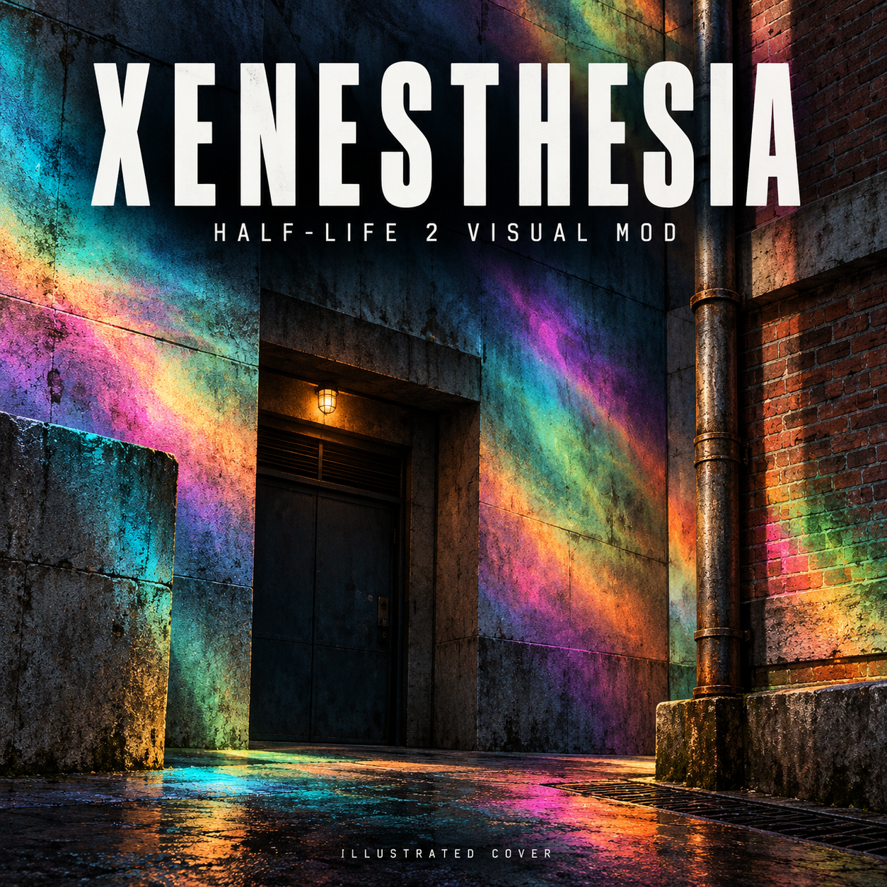

# Xenesthesia — local release candidate

**Not published. Awaiting playtest feedback and an explicit go-ahead to upload.**

The current candidate combines small, unevenly timed texture pulses with rich
prismatic colours. Texture motion is attached to supported materials. It includes
supported first-person hands and weapons and keeps the scene detail sharp.

## Cover candidate

Promotional illustration created with the built-in image-generation tool. It is
labelled as an illustrated cover and is separate from the genuine game gallery.
The exact prompt and provenance are included in `media/cover-prompt.txt`.

## Genuine in-game gallery candidates

Coast, native 1920×1080 capture from this candidate. The HUD and weapon remain
readable, with prismatic colour bands over the road and sky.

Ravenholm, native 1920×1080 capture from this candidate. Shows the darker scene,
flashlight and SMG. Gallery images have no generated effects or retouching.

The separate `media/wall-motion.mp4` is an inspection sequence of twelve native
screenshots at 2 fps, with the colour layer off. It demonstrates the smaller
texture movement, but is not a continuous gameplay trailer.

## Contents and controls

`workshop-description.txt` contains the proposed listing copy. `INSTALL.txt`
explains manual installation and full removal. F4 is an optional colour-only
toggle. Removing/disabling the addon and restarting is the complete bypass.

The manual-install ZIP contains the VPK, instructions and licensing notices.
`workshop-content` contains only the verified runtime files for an eventual
Workshop upload; the preview art and descriptions are separate upload fields.

## Evidence and remaining checks

Ten package/generator tests passed for the current shader and material build.
Native Anode checks covered coast daylight, Ravenholm, flashlight, pistol/hands,
SMG, walking, camera turns, the colour toggle and pause menu at 1920×1080.
A single local 2,610-frame coast run averaged 337 fps; this is not a minimum-rate
promise or a benchmark for the whole campaign. Full details are in VALIDATION.md.

The owner is playtesting the gentler revision on the main desktop. The desired
motion/colour balance, broader campaign coverage and final gallery selection
remain subject to that feedback. Clean Workshop-download installation can only
be tested after the owner explicitly authorizes creating and uploading the item.
